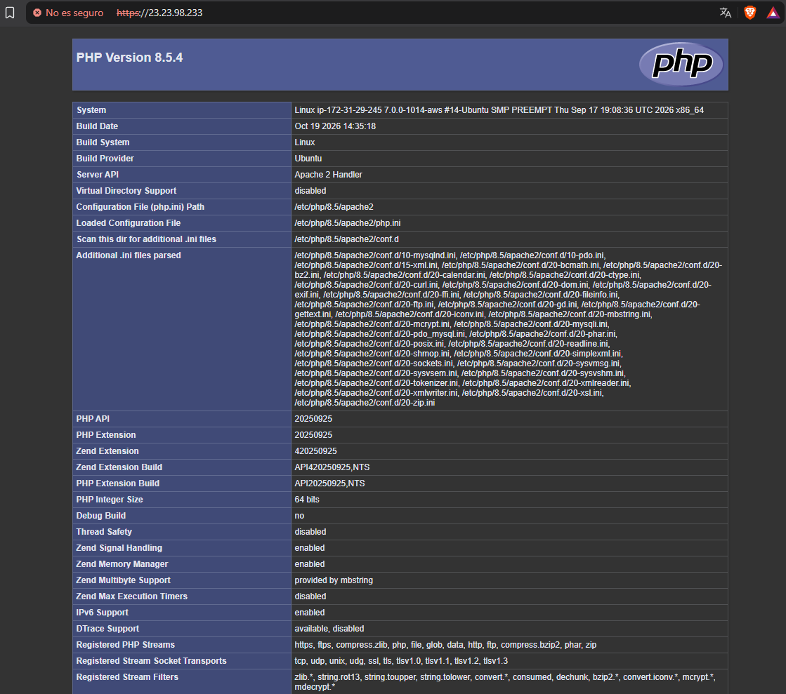

# Certificado SSL/TLS autofirmado en Apache

## Índice

1. [Introducción](#1-introducción)
2. [Estructura del repositorio](#2-estructura-del-repositorio)
3. [Instalación de la pila LAMP](#3-instalación-de-la-pila-lamp)
4. [Creación del certificado autofirmado](#4-creación-del-certificado-autofirmado)
5. [Configuración de Apache](#5-configuración-de-apache)
6. [Automatización con scripts Bash](#6-automatización-con-scripts-bash)
7. [Conclusiones](#7-conclusiones)

---

## 1. Introducción
  ¿Qué es un certificado SSL/TLS y para qué sirve?
- Un certificado SSL/TLS tiene la misma función que un dni, comprueba tu identidad al entrar a la web y permite cifrar la información que transcurre entre el cliente y el usuario. Este certificado sirve para cifrar la comunicación.
Al tener este certificado instalado en la web navegaremos por https.

 ¿Certificado Autofirmado vs. Emitido por una CA?
- Para que una web confie en ese identificador hace falta un certificado y aqui existen dos tipos. Los autofirmados y los certificados por CA(Autoridad de Certificacion). La gran diferencia que existen entre estos, es los navegadores tienen una lista interna de *CAs* en lso que confían por lo que tener un certificado *autofirmado* el navegador va a detectar el sitio como: "La conexión no es privada" o "El sitio no es seguro". La comunicación estará cifrada, pero el navegador no garantiza que sea seguro del todo.

Objetivo del proyecto:
- En este proyecto automatizaremos la instalacion de la pila LAMP seguido de configurar el https de Apache.

## 2. Estructura del repositorio

```
.
├── README.md
├── conf
│   ├── 000-default.conf
│   └── default-ssl.conf
└── scripts
    ├── .env
    ├── install_lamp.sh
    └── setup_selfsigned_certificate.sh
```

| Archivo | Descripción |
|---|---|
| `README.md` | Documento técnico (este archivo). |
| `conf/000-default.conf` | VirtualHost del puerto 80, con redirección a HTTPS. |
| `conf/default-ssl.conf` | VirtualHost del puerto 443, con la configuración del certificado. |
| `scripts/.env` | Variables de configuración usadas por los scripts. |
| `scripts/install_lamp.sh` | Automatiza la instalación de la pila LAMP. |
| `scripts/setup_selfsigned_certificate.sh` | Automatiza la creación y configuración del certificado autofirmado. |

---

Clonar el repositorio:

```bash
git clone https://github.com/<usuario>/<repositorio>.git
cd <repositorio>/scripts
```

---

## 3. Instalación de la pila LAMP

LAMP = **L**inux + **A**pache + **M**ySQL + **P**HP.

### 3.1. Script `install_lamp.sh`

```bash
#!/bin/bash

# Configuramos el script para que se muestren los comandos
# y finalice cuando hay un error en la ejecución
set -ex

# Actualiza la lista de paquetes
apt update

# Actualizamos los paquetes del sistema operativo
apt upgrade -y

# Instalamos el servidor web Apache
apt install apache2 -y

# Copiamos nuestro archivo de configuración de VirtualHost
cp ../conf/000-default.conf /etc/apache2/sites-available

# Instalamos los paquetes necesarios para tener PHP
apt install php libapache2-mod-php php-mysql -y

# Habilitamos el módulo rewrite de Apache
a2enmod rewrite

# Reiniciamos el servicio de Apache
systemctl restart apache2

# Copiar el archivo php/index.php a /var/www/html
cp ../php/index.php /var/www/html

# Modificamos el propietario del diretoro /var/www/html
chown -R www-data:www-data /var/www/html

# Instalamos MySQL Server
apt install mysql-server -y
```

### 3.2. Ejecución

```bash
chmod +x install_lamp.sh
sudo ./install_lamp.sh
```


---

## 4. Creación del certificado autofirmado

### 4.1. Variables de configuración (`scripts/.env`)

```bash
# Datos del certificado. Cada uno tiene su información
OPENSSL_COUNTRY="ES"
OPENSSL_PROVINCE="<Provincia>"
OPENSSL_LOCALITY="<Localidad>"
OPENSSL_ORGANIZATION="<Organización>"
OPENSSL_ORGUNIT="<Departamento>"
OPENSSL_COMMON_NAME="<dominio o IP del servidor>"
OPENSSL_EMAIL="<correo@ejemplo.com>"

```

### 4.2. Generación del certificado y la clave privada

```bash
sudo openssl req \
  -x509 \
  -nodes \
  -days 365 \
  -newkey rsa:4096 \
  -keyout /etc/ssl/private/apache-selfsigned.key \
  -out /etc/ssl/certs/apache-selfsigned.crt \
  -subj "/C=$OPENSSL_COUNTRY/ST=$OPENSSL_PROVINCE/L=$OPENSSL_LOCALITY/O=$OPENSSL_ORGANIZATION/OU=$OPENSSL_ORGUNIT/CN=$OPENSSL_COMMON_NAME/emailAddress=$OPENSSL_EMAIL"

```

- Comprobamos nuestras claves:
```bash
cat /etc/ssl/private/apache-selfsigned.key
```
```bash
cat /etc/ssl/certs/apache-selfsigned.crt
```

---

## 5. Configuración de Apache

### 5.1. VirtualHost HTTPS (`conf/default-ssl.conf`)

```apache
    <VirtualHost *:443>
    #ServerName practica-https.local
    DocumentRoot /var/www/html
    DirectoryIndex index.php index.html

    SSLEngine on
    SSLCertificateFile /etc/ssl/certs/apache-selfsigned.crt
    SSLCertificateKeyFile /etc/ssl/private/apache-selfsigned.key
</VirtualHost>
```

| Directiva | Función |
|---|---|
| `<VirtualHost *:443>` | Escucha peticiones HTTPS en el puerto 443. |
| `SSLEngine on` | Activa SSL/TLS en este VirtualHost. |
| `SSLCertificateFile` | Ruta del certificado. |
| `SSLCertificateKeyFile` | Ruta de la clave privada. |

### 5.2. VirtualHost HTTP con redirección a HTTPS (`conf/000-default.conf`)

```apache
<VirtualHost *:80>
    #ServerName practica-https.local
    DocumentRoot /var/www/html

    # Redirige al puerto 443 (HTTPS)
    RewriteEngine On
    RewriteCond %{HTTPS} off
    RewriteRule ^ https://%{HTTP_HOST}%{REQUEST_URI} [L,R=301]
</VirtualHost>
```

### 5.3. Activación de módulos y sitios

```bash
# Copiamos los archivos de configuracion de Apache 
cp ../conf/default-ssl.conf  /etc/apache2/sites-available/default-ssl.conf
cp ../conf/000-default.conf /etc/apache2/sites-available/000-default.conf

# Habilitamos el virtual host de apache para ssl
sudo a2ensite default-ssl.conf

# Habilitamos el virtual host de apache para la redireccion a https
sudo a2ensite 000-default.conf

#Habilitamos el modulo de SSL en Apache
sudo a2enmod ssl

# Para que el servidor web Apache pueda hacer la redirección de HTTP a HTTPS es necesario habilitar el módulo rewrite en Apache
sudo a2enmod rewrite

# Reiniciamos Apache para aplicar los cambios
sudo systemctl restart apache2
```

---

## 6. Automatización con scripts Bash

### 6.1. Script `setup_selfsigned_certificate.sh`

```bash
#!/bin/bash
set -x
# Importamos las variables de entorno
source .env

# Creamos el certificado autofirmado
sudo openssl req \
  -x509 \
  -nodes \
  -days 365 \
  -newkey rsa:4096 \
  -keyout /etc/ssl/private/apache-selfsigned.key \
  -out /etc/ssl/certs/apache-selfsigned.crt \
  -subj "/C=$OPENSSL_COUNTRY/ST=$OPENSSL_PROVINCE/L=$OPENSSL_LOCALITY/O=$OPENSSL_ORGANIZATION/OU=$OPENSSL_ORGUNIT/CN=$OPENSSL_COMMON_NAME/emailAddress=$OPENSSL_EMAIL"

# Copiamos los archivos de configuracion de Apache 
cp ../conf/default-ssl.conf  /etc/apache2/sites-available/default-ssl.conf
cp ../conf/000-default.conf /etc/apache2/sites-available/000-default.conf

# Habilitamos el virtual host de apache para ssl
sudo a2ensite default-ssl.conf

# Habilitamos el virtual host de apache para la redireccion a https
sudo a2ensite 000-default.conf

#Habilitamos el modulo de SSL en Apache
sudo a2enmod ssl

# Para que el servidor web Apache pueda hacer la redirección de HTTP a HTTPS es necesario habilitar el módulo rewrite en Apache
sudo a2enmod rewrite


# Reiniciamos Apache para aplicar los cambios
sudo systemctl restart apache2
```

### 6.2. Orden de ejecución

```bash
cd scripts
chmod +x install_lamp.sh setup_selfsigned_certificate.sh

sudo ./install_lamp.sh
sudo ./setup_selfsigned_certificate.sh
```
---

---

### 6.3. Acceso desde el navegador

1. Accede a `https://<IP o dominio>`.
2. El navegador mostrará una advertencia de **conexión no privada** porque el certificado no está firmado por una CA de confianza. Pulsa en *Avanzado → Continuar*.
3. Comprueba que la página carga y que el candado indica que la conexión usa HTTPS.
4. Accede a `http://<IP o dominio>` y verifica que redirige automáticamente a HTTPS.




## 7. Conclusiones

- Hemos conseguido lanzar un servidor LAMP + HTTPS con certificado autofirmado, todo automatizado.

- Las limitaciones que tiene un servicio autofirmado, es que podemos conseguir ese cifrado de información, pero el navegador no puede darnos el visto bueno de este, ya que no aparece en sus registros de CAs.

---

## Autor

**`Alejandro Castillo Andrés`**